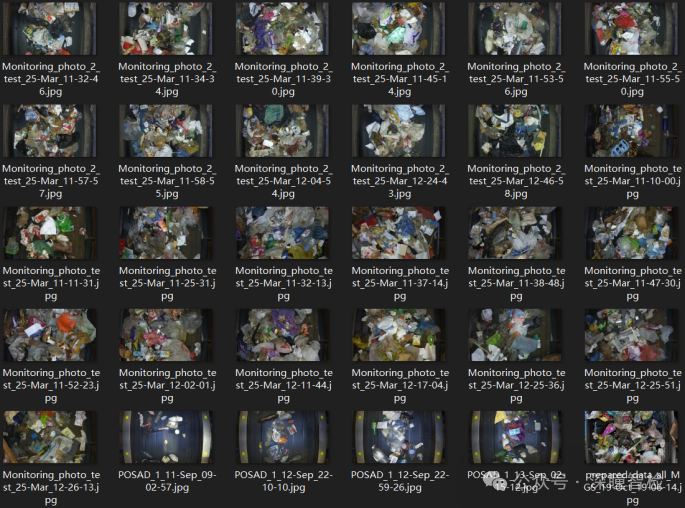
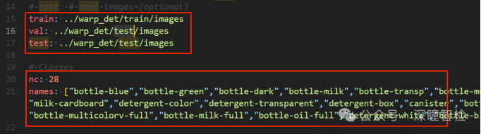
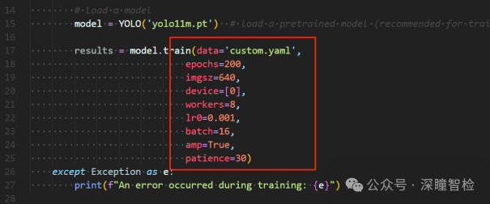
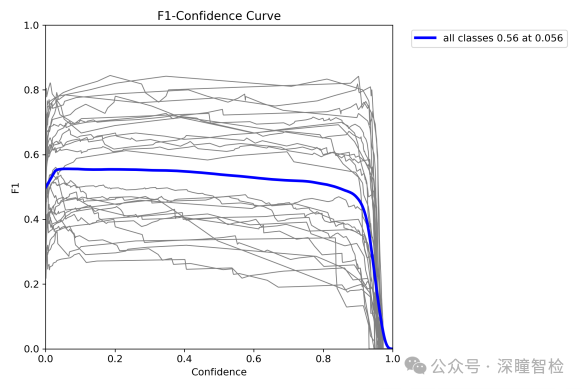
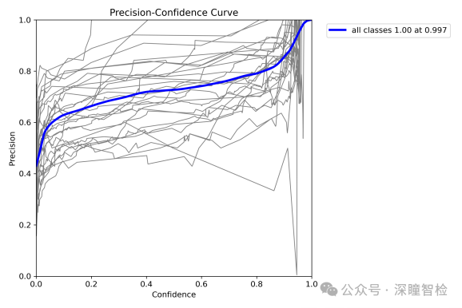
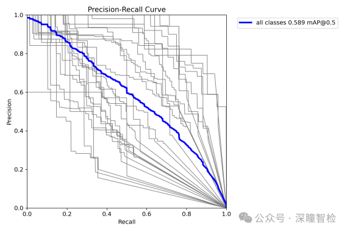
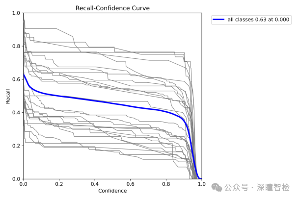
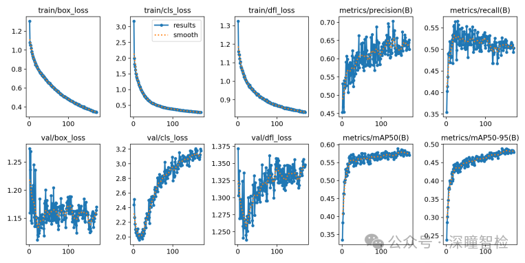
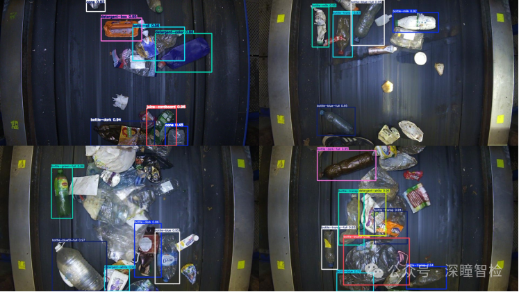
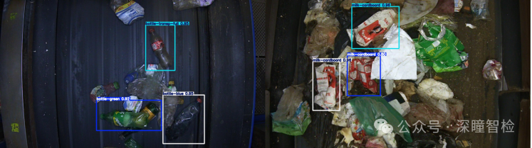

# 08-Real-World Application of Recyclable Waste Object Detection Based on Yolo11

## 1. Data phase

### 1.1 Data Set Preparation

The Recyclable Waste Dataset is a dataset for target detection tasks. Its potential application areas include the environmental industry as shown in the following figure:

Dataset Introduction: The issue of waste pollution is becoming increasingly severe, especially the accumulation of plastic waste poses a significant threat to the environment and ecosystem. To effectively manage waste, automated waste sorting systems are becoming crucial. These systems typically rely on computer vision technology, particularly deep learning models, to detect, classify, and segment waste.

The dataset aims to provide a diverse and high-quality image dataset for waste identification tasks in recycling plants, especially in complex industrial environments (such as poor lighting conditions, object overlaps or deformations). The detection task images include **2452 training images** and **522 validation images**. The dataset contains 28 different waste categories, covering plastic bottles, glass bottles, cardboard, cleaning agents, cans, and canned containers, among others. Each category has multiple subcategories, such as 17 subcategories for plastic bottles and 3 subcategories for glass bottles.

1.2 Data Set Structure Organization

The YOLO format dataset structure is as follows:

**warp_det******

**- train******

**-- images******

**-- labels******

**- test******

**-- images******

**-- labels******

The training set contains 2452 images, while the validation set consists of 522 images.

### 1.3 Data Set Download

[Note: The warp_det folder should be prepared, which should be in the same directory level as the following project yolov11_det. Do not place the warp_det folder inside the project.]

☆ You can directly obtain the converted Yolo format dataset (as shown in the following figure) by **seeing the end of this document**.

### 1.4 Environmental Installation

Execute the following instructions:

pip install ultralytics==8.3.59 -i https://pypi.tuna.tsinghua.edu.cn/simple

## 2. Training phase

### 2.1 Configuration File Modifications

[Prerequisites: CUDA, Torch, and Ultralytics versions must be compatible and available, using the Yolo11 M pre-trained model]

[Need to enter the project "yolov11_det"]

Modify the data configuration file ./custom.yaml, set the training and validation sets paths, ensure there is a consistent number of categories and category names.

### 2.2 Execute Training Commands

Modify the training parameters in the train.py file as needed, such as: for Windows systems, set workers to 0; for Linux systems, set it to 8; other parameters should be modified according to hardware configuration requirements.

Execute training instructions:

python train.py

After training 200 epochs (with early stopping mechanism, 172 epochs), the model is saved in the runs/detect/train/weights folder.

### **2.3 Results Graph Display and Analysis**

1) F1_curve.png (F1 score)

As shown in the figure, when the confidence is 0.056, the F1 score for all classes is 0.56; this indicates that the model performs well with a confidence level of 0.056, demonstrating certain accuracy and recall.

What is the F1 score? The F1 score is the harmonic mean of precision and recall, taking into account both the accuracy of model predictions and their coverage.

2) P_curve.png (Accuracy Curve)

The deep blue line in the figure represents the overall accuracy, which increases with increasing confidence. At a confidence level of 0.997, the accuracy reaches 1.00. The remaining 28 lines represent the accuracy for each of the 28 categories at different confidence levels.

Precision curve, which helps analyze the model's performance in detection tasks, especially under different confidence settings. By this curve, a suitable confidence threshold can be selected to optimize the model's detection results, balancing precision and recall.

3) PR_curve.png (Precision-Recall curve)

The curve in the image is a Precision-Recall Curve (PR Curve), which shows the precision and recall of the classifier at different thresholds. Specifically, the horizontal axis represents Recall (recall rate), ranging from 0.0 to 1.0; the vertical axis represents Precision (precision rate), ranging from 0.0 to 1.0. There are mainly 29 curves in the figure:

(1) The color line represents the precision-recall curve of 28 categories, with each category having its own precision.

(2) The deep blue line represents the average precision-recall curve for all categories, with precision also stabilizing around 0.589.

All 28 curves show a slight decrease in precision with an increase in recall rate, but the overall precision remains at a very high level.

This curve can evaluate the overall performance of the model in the target detection task and find an appropriate confidence threshold to achieve the best balance between precision and recall. The closer the PR curve is to the upper right corner, the better the model performs, and the larger the area under the curve, indicating that the model performs more consistently across different confidence levels.

4) R_curve.png (Recall curve)

The R curve in the diagram represents the Recall-Confidence Curve (Recall-Confidence Curve), which shows the recall rate at different confidence levels. Specifically, the horizontal axis represents confidence levels, ranging from 0.0 to 1.0; the vertical axis represents recall rates, ranging from 0.0 to 1.0. The main feature of the graph is 29 curves:

(1) 28 color lines: Recall rate for 28 categories as a function of confidence. This curve shows that the recall rate for each category initially changes less with increasing confidence, then rapidly decreases after a certain point.

(2) Deep blue line: Represents the average recall rate of all categories as a function of confidence.

Display the recall performance of the model under different confidence thresholds. The recall curve aids in evaluating the model's ability to detect true targets in a target detection task. By analyzing this curve, users can assess the model's detection capabilities and analyze whether the model is comprehensively detecting true targets at varying thresholds. If the recall curve performs well at lower confidence levels, it indicates that the model can effectively detect most targets; if the curve declines rapidly, adjustments to the model or dataset may be necessary to avoid missed detection issues.

5) results.png (results indicator curve)

This image file shows the trend of key metrics (such as loss, mAP) during training.

box_loss: Position loss curve

Meaning: Bounding box loss, measuring the error between the predicted bounding box and the true one. Includes center position, width, height, etc.

Chart: Typically displays the loss value curve on training rounds or steps, with lower values indicating more accurate predictions of bounding boxes by the model.

dfl_loss: Target Detection Loss Curve

Meaning: Distribution Focal Loss, which addresses the issue of class imbalance in positioning tasks and helps models focus more on difficult-to-predict targets.

Chart: Shows the loss value curve for training epochs or steps, with lower values indicating better performance in distributed positioning tasks.

cls_loss: Classification Loss Curve

Meaning: Category loss, measuring the gap between predicted class labels and true class labels. Reflects the accuracy of the classifier.

Chart: Shows the loss value curve for training epochs or steps, with lower values indicating better classification performance.

Precision (B): Precision curve

Meaning: Precision (B-class), indicating how many proportion of true positives are predicted by the model. B-class usually refers to background class.

Chart: Shows the precision curve on training rounds or steps, with higher precision indicating higher accuracy in background class detection.

Recall (B) Curve

Meaning: Recall rate (B-class), which represents the proportion of actual positive samples detected by the model. B-class usually refers to background classes.

Chart: Shows recall curves on training epochs or steps, with higher recall indicating stronger detection capabilities of the model for background classes.

mAP50 (B): Average Precision when IoU threshold is 0.5

Mean Accuracy (B-class) at IoU threshold of 0.5, reflects the model's accuracy at this IoU threshold.

Chart: Shows the mAP50 value curve on training epochs or steps, with higher mAP50 values indicating higher detection accuracy of background classes by the model.

mAP50-95 (B): The average precision between 0.5 and 0.95 for IoU thresholds

Mean accuracy (B-class) within the range of IoU thresholds from 0.5 to 0.95, evaluating the detection performance of models under different IoU thresholds.

Chart: Shows the mAP50-95 value curve on training epochs or steps, with higher mAP50-95 values indicating stronger overall performance of the model on background classes.

## 3. Inference phase

### 3.1 Starting the Inference

Predict using the trained model (input test image folder input_test_images):

Execute the following instructions:

python predict.py

After the test is completed, the results are saved in the output_results folder.

### 3.2 Output Display

Output:

## Payment

Here is a pay link on Stripe ( https://buy.stripe.com/3cs8yP7sY87d0vu9AB ). Please contact me lonlonago@foxmail.com after funding $89, and I will send you a complete data files , thank you!

